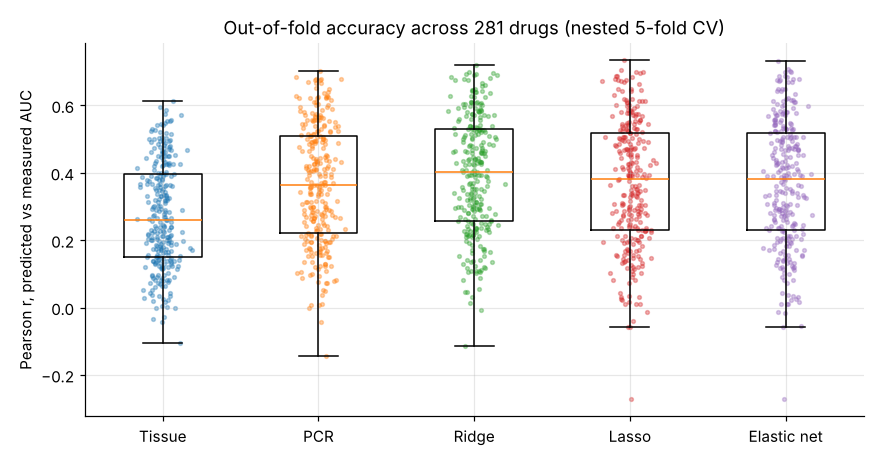

# Predicting cancer drug response from gene expression

*Executive summary. Details in the [model development document](model_development_document.md) and [validation report](validation_report.md).*

## The question

Can the gene expression of a cancer cell line predict how strongly it responds to a drug, beyond what its cancer type already tells us? And which genes carry the signal? Drug-discovery teams use models like this to suggest biomarkers, pick cell-line models for new compounds, and find new uses for existing drugs.

## How it was tested

* **Data:** 281 anti-cancer drugs, each screened on 300–944 cancer cell lines by the Wellcome Sanger Institute (GDSC2), with RNA-seq profiles of 18,407 genes (Cell Model Passports).
* **Models:** one model per drug: ridge, lasso, elastic net, adaptive lasso, group lasso and principal components regression, against a model that knows only the cancer type.
* **Evaluation:** nested 5-fold cross-validation. Every preprocessing step, including a correction for a strong batch effect between two RNA-seq pipelines, is fitted inside the training folds.

## The answer

| Model | Median r (281 drugs) | Beats cancer type alone | Ranks lines within a cancer type (median Spearman) |
|---|---|---|---|
| Cancer type only | 0.26 | | n/a |
| **Ridge** | **0.40** | **97.5% of drugs** | **0.19** |
| Lasso / elastic net | 0.38 | 88% | 0.15 |
| PCR | 0.36 | 89% | 0.16 |

**Five findings:**

1. **Expression adds real information to cancer type for almost every drug.** The gain is largest for drugs targeting apoptosis regulation and ERK–MAPK signalling. For Nutlin-3a (MDM2), r rises from 0.38 to 0.67.
2. **Dense beats sparse.** Ridge, which keeps every gene with small weights, beats the lasso and elastic net on 85% of drugs. Drug response in cell lines is spread across many co-expressed genes rather than a few switches. The elastic net itself preferred its most ridge-like setting in 83% of fits.
3. **The models rediscover known biology.** The top genes include ERBB2 for lapatinib, BCL2 for venetoclax, SLFN11 for olaparib, EGFR for erlotinib, and the TP53 targets CDKN1A, PHLDA3 and TRIM22 for Nutlin-3a. Without ever seeing mutation data, predictions separate BRAF-mutant lines for dabrafenib (ROC AUC 0.82).
4. **Measurement noise caps accuracy.** Sanger's two assays agree only at a median r of 0.53 for the same drug and cell line. Scored against the other assay, the models reach 71% of that ceiling.
5. **New cancer types are a blind spot.** When a cancer type is left out of training, ranking within it holds up for solid tumours (79–94% retained) but roughly halves for blood cancers and skin cancers (mostly melanoma).

## Recommendations

1. **Use ridge for prediction, and the elastic net for gene lists reported as selection frequencies.** Only about 6 of ~50 selected genes recur in all five folds, so a single gene list is not a finding.
2. **Restrict use to cancer types represented in training.** Retrain before applying to haematological lines or any new tissue.
3. **Invest in data quality and breadth, not model complexity.** The between-assay ceiling and the unseen-tissue drop matter more than the choice between penalties. A larger gene set (5,000) helped on 81% of panel drugs.
4. **Validate in an independent lab next.** Code to score the models against the Broad Institute's PRISM screen is ready; it needs data access.

*Data: Genomics of Drug Sensitivity in Cancer (GDSC1, GDSC2 release 8.5) and Cell Model Passports, Wellcome Sanger Institute.*
