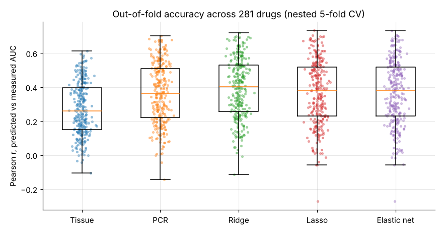
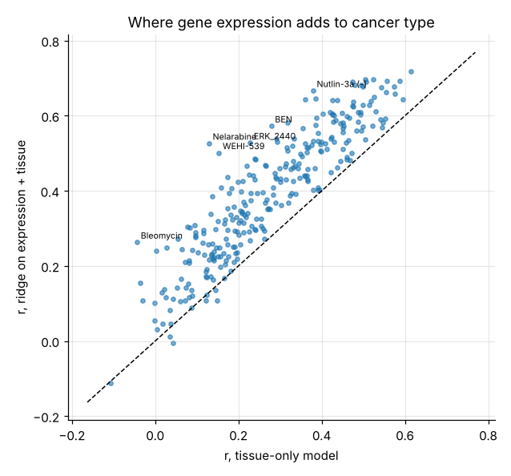
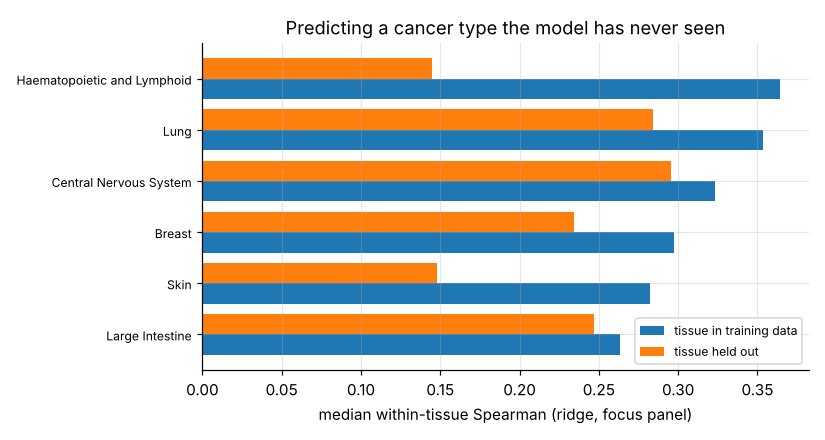
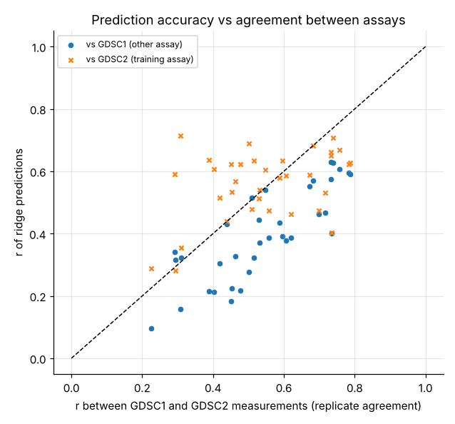

# Model development document: predicting cancer drug response from gene expression

*Version 1.0, November 2026. Code: `src/drugresponse/`. Results: `outputs/tables/`. Independent checks: [validation report](validation_report.md).*

## 1. Purpose and scope

**Question.** Given a cancer cell line's gene expression profile, how well can regularised regression predict its sensitivity to each of 281 anti-cancer drugs? How much does expression add beyond the cancer type, and which genes carry the signal?

**Why it matters.** Drug-sensitivity models are used in pharmaceutical R&D to:
* propose biomarkers for patient selection in clinical trials;
* prioritise cell-line models for new compounds;
* reposition existing drugs to new cancer types.

The underlying statistical problem, predicting an outcome from far more correlated features than samples, also recurs in credit scoring with alternative data, marketing attribution and text models.

**Scope.** Cell lines only. Cell-line sensitivity is a laboratory proxy, not a clinical outcome; nothing here is validated for patient use.

## 2. Data

| Source | Content | Use |
|---|---|---|
| GDSC2, release 8.5 (Wellcome Sanger Institute) | fitted dose-response curves, CellTiter-Glo assay: 295 drugs x up to 969 cell lines | response (training and evaluation) |
| GDSC1, release 8.5 | 402 drugs, Syto60 / resazurin assays | cross-assay test |
| Cell Model Passports | RNA-seq (RSEM, log2 TPM + 1) from Sanger and Broad pipelines; tissue and cancer type; driver mutations | features, stratification, biomarker checks |

All files are downloaded from Sanger's public storage by `python scripts/run_pipeline.py --data`.

**Response.** The area under the fitted dose-response curve (AUC), scaled to 0–1 over the screened concentration range. 1 means no effect at any tested dose; lower means more sensitive. The alternative, ln(IC50), is often extrapolated beyond the highest tested concentration, so it is used only as a robustness check.

**Cell lines and drugs.** 953 lines have both expression and GDSC response data. Drugs screened in at least 300 GDSC2 lines are analysed (281 of 295; median 870 lines per drug).

**Genes.** 18,407 genes expressed (log2 TPM + 1 ≥ 1) in at least 10% of lines. Within each training fold the 2,000 most variable genes are used (section 4).

## 3. Batch effect

Expression for 550 lines comes from the Broad Institute's pipeline and for 403 from Sanger's. Both are on the log2(TPM + 1) scale, but the source is almost perfectly predictable from the profiles: a logistic regression on 20 principal components separates them with AUC 0.998.

The two sources also sampled tissues unevenly, so a naive per-source centring would remove real tissue differences. Instead, each gene's source effect is estimated by regressing it on [source indicator, tissue indicators] and only the source part is subtracted. After correction, source predictability falls to AUC 0.508 while tissue classification accuracy is unchanged (0.705 → 0.707). The correction is estimated inside each training fold.

## 4. Model design

**Features.** For each outer fold, using only the training lines and never the response:
1. batch correction (section 3);
2. the 2,000 most variable corrected genes;
3. one-hot tissue indicators;
4. standardisation with training means and standard deviations.

The gene count is fixed at 2,000 for compute reasons. It was not tuned; 1,000 and 5,000 are tested in section 7.

**Models** (one regression per drug):

| Model | What it assumes | Implementation |
|---|---|---|
| Mean | nothing | training mean |
| Tissue | response depends on cancer type only | least squares on tissue indicators |
| PCR | signal lies in the main axes of expression variation | principal components regression, k ∈ {1, …, 200} by CV |
| Ridge | many small effects spread across correlated genes | closed form for all 40 penalties from one n × n SVD (kernel form) |
| Lasso | a few genes matter | scikit-learn coordinate descent, 30 penalties |
| Elastic net | sparse, but correlated genes enter together | mixing α ∈ {0.2, 0.8} × 30 penalties |
| Adaptive lasso | sparse, with less shrinkage of large effects | lasso on columns rescaled by \|ridge coefficient\| (focus panel) |
| Group lasso | whole gene programmes matter | L2,1 penalty over 100 co-expression modules (k-means on gene profiles in the training fold), FISTA from scratch (focus panel) |

Tissue indicators are offered to every model alongside the genes, so the expression models can use cancer type too. The question is whether they add to it.

**Nested cross-validation.**
* *Outer loop, for evaluation.* Each cell line is assigned once to one of five folds, stratified by tissue. The same assignment is used for every drug and model, so comparisons are paired.
* *Inner loop, for tuning.* Five random folds within the outer-training lines choose every penalty, mixing weight and component count.
* *Reporting.* Only outer-fold predictions are reported.

**Focus panel.** The slower models and all robustness designs run on 36 drugs, chosen by a rule fixed before any model was evaluated (`drugresponse.panel`):
* the 30 drugs screened in both GDSC1 and GDSC2 (≥ 300 lines each) whose GDSC2 AUC varies most;
* plus six drugs with established biomarkers: Nutlin-3a, olaparib, lapatinib, afatinib, venetoclax and erlotinib. Dabrafenib and trametinib were already in the top 30.

## 5. Evaluation metrics

* **r**: Pearson correlation between out-of-fold predicted and measured AUC across all lines. Also reported: Spearman ρ, RMSE and out-of-fold R².
* **Within-tissue Spearman.** How well a model ranks lines inside each cancer type, averaged over tissues with ≥ 15 lines and weighted by line count. Tissue alone cannot do this, so it isolates what expression adds.
* **Gain over tissue.** r(model) − r(Tissue) per drug, with the share of drugs on which the model wins and a Wilcoxon signed-rank test. The test is descriptive only, because drugs sharing a target are not independent.
* **Selection stability.** For the sparse models: genes selected in all five folds, and the mean Jaccard overlap between folds.

## 6. Results

### 6.1 Accuracy across 281 drugs

Medians across drugs of out-of-fold metrics (`outputs/tables/summary.csv`):

| Model | Median r | Median R² | Median within-tissue Spearman | Drugs with r > 0.3 | Beats tissue (share of drugs) | Median gain in r vs tissue |
|---|---|---|---|---|---|---|
| Mean | −0.06 | 0.00 | n/a | 0% | 0% | |
| Tissue | 0.261 | 0.055 | n/a | 43% | | |
| PCR | 0.364 | 0.128 | 0.156 | 60% | 89% | +0.090 |
| **Ridge** | **0.402** | **0.161** | **0.194** | **67%** | **97.5%** | **+0.116** |
| Lasso | 0.382 | 0.142 | 0.151 | 61% | 88% | +0.087 |
| Elastic net | 0.382 | 0.144 | 0.155 | 61% | 88% | +0.088 |

**Findings**

1. **Expression adds to cancer type for almost every drug.** Ridge beats the tissue-only model on 274 of 281 drugs, with a median gain of 0.12 in r (Wilcoxon p < 10⁻⁴⁰; descriptive, since drugs are not independent). Cancer type alone reaches a median r of 0.26.
2. **Dense beats sparse.** Ridge has the higher r on 85% of drugs against both the lasso and the elastic net, and it is the best of the five models for 220 of 281 drugs. The median margin is small (0.027 in r, interquartile range 0.008–0.045) but very consistent. When allowed to choose, the elastic net picked the more ridge-like mixing weight (α = 0.2) in 83% of fits. Drug response in cell lines is a polygenic signal spread across many co-expressed genes, not a handful of switches.
3. **Within a cancer type the signal is weaker.** Ridge's median within-tissue Spearman is 0.19; it exceeds 0.2 for 48% of drugs. A good part of every model's overall accuracy is recognising tissue of origin from expression.
4. **Predictability depends on the drug, not the model.** 90 drugs reach r > 0.5 with ridge and 38 stay below 0.2. The Spearman correlation between a drug's response spread (SD of AUC) and ridge's r is 0.74: drugs that barely separate lines have little to predict.

### 6.2 Which drugs

| Most predictable (ridge r) | | Largest gain over tissue | |
|---|---|---|---|
| Schweinfurthin A | 0.72 | Nelarabine | +0.40 (0.13 → 0.53) |
| Cytarabine | 0.70 | WEHI-539 (BCL-XL) | +0.35 |
| Camptothecin (TOP1) | 0.70 | Bleomycin | +0.31 |
| Vorinostat (HDAC) | 0.69 | ERK_2440 (ERK1/2) | +0.30 |
| BI-2536 (PLK1) | 0.69 | Nutlin-3a (MDM2) | +0.29 (0.38 → 0.67) |

By target pathway (pathways with ≥ 5 drugs, `by_pathway.csv`), the most predictable are ERK–MAPK signalling (median r 0.55, 15 drugs), mitosis (0.54), DNA replication (0.54) and cell cycle (0.53). The least predictable are chromatin histone acetylation (0.27) and RTK signalling (0.24). The largest median gains over tissue are in apoptosis regulation (+0.19) and ERK–MAPK signalling (+0.17).

### 6.3 Selection and stability

At their CV-chosen penalties the lasso and elastic net keep a median of about 50 genes per fold, but only 6 are selected in all five folds. The mean Jaccard overlap between folds is 0.23. Each fold removes only 20% of the lines, so the exact gene lists are fragile even when accuracy is stable: a direct consequence of correlated genes (learn/03). Gene lists are therefore reported as selection frequencies (`top_genes.csv`).

For Nutlin-3a, the genes chosen in all five folds with negative coefficients (higher expression, more sensitive) include CDKN1A (p21), PHLDA3, TRIM22, PURPL and PPP1R13L. All are transcriptional targets of wild-type TP53, the pathway the drug acts through ([notebook 02](../notebooks/02_inside_one_drug.ipynb)).

### 6.4 Model choice

**Ridge on the 2,000 most variable batch-corrected genes plus tissue indicators** is the recommended model for prediction: the most accurate on 78% of drugs and the cheapest to fit. The **elastic net** is the companion for interpretation: 0.02 lower in median r (0.382 vs 0.402), but it yields a short, rankable gene list. Report it with selection frequencies, never as a single list.

## 7. Robustness (focus panel, 36 drugs)

All on the focus panel (section 4); tables in `outputs/tables/`, analysis in [notebook 05](../notebooks/05_robustness.ipynb).

### 7.1 Slower models

| Model | Median r | Median within-tissue Spearman | Beats tissue | Genes selected (median per fold) | Fold-to-fold Jaccard |
|---|---|---|---|---|---|
| **Ridge** | **0.586** | **0.287** | 100% | all 2,000 | |
| Group lasso (co-expression modules) | 0.569 | 0.230 | 100% | 1,031 | 0.39 |
| Elastic net | 0.564 | 0.276 | 97% | | |
| Lasso | 0.562 | 0.271 | 97% | | |
| PCR | 0.557 | 0.253 | 100% | | |
| Adaptive lasso | 0.533 | 0.260 | 92% | 208 | 0.28 |
| Tissue | 0.426 | | | | |

Ridge beats the group lasso and the adaptive lasso on 92% of panel drugs. The group lasso is the most stable selector (Jaccard 0.39), but it keeps about half of all genes. That count is overstated: with the production solver limit (400 FISTA iterations) small-penalty solutions are not fully converged. A tight solve on Nutlin-3a gives similar accuracy (within 0.02 in r) with up to a third fewer active modules (validation report, section 3). The adaptive lasso's extra sparsity costs accuracy.

### 7.2 Gene filter and response measure

| Design | Ridge r | Lasso r | Ridge within-tissue |
|---|---|---|---|
| 1,000 genes | 0.575 | 0.553 | 0.280 |
| **2,000 genes (main)** | 0.586 | 0.562 | 0.287 |
| 5,000 genes | 0.598 | 0.587 | 0.319 |
| ln(IC50) as response (2,000 genes) | 0.616 | 0.597 | 0.390 |

More genes help a little: 5,000 beats 2,000 on 81% of panel drugs. One reason is that the variance filter drops some biologically important genes. MDM2, the direct target of Nutlin-3a, ranks 4,694th by variance and never enters the 2,000-gene model. The main setting is therefore conservative. ln(IC50) gives higher correlations, but its values are often extrapolated beyond the tested range, so AUC remains the primary response.

### 7.3 A cancer type the model has never seen

Train on every other tissue, predict the held-out one; median within-tissue Spearman across panel drugs (ridge):

| Held-out tissue | Lines | Tissue seen in training | Tissue unseen |
|---|---|---|---|
| Lung | 169 | 0.354 | 0.284 |
| Central nervous system | 54 | 0.323 | 0.295 |
| Breast | 50 | 0.297 | 0.234 |
| Large intestine | 47 | 0.264 | 0.247 |
| Skin | 57 | 0.282 | 0.148 |
| Haematopoietic and lymphoid | 163 | 0.364 | 0.144 |

For most solid tumours, ranking within an unseen cancer type keeps 79–94% of its accuracy. It collapses for blood cancers and skin: their biology differs most from the rest, and the models also mis-estimate the average response of blood cancers (median bias +0.07 in AUC: predicted less sensitive than they really are). **Applying the models to a cancer type absent from training is unsafe**, particularly a haematological one.

### 7.4 Another assay

For 35 panel drugs screened in both GDSC1 and GDSC2, GDSC2-trained predictions were scored against GDSC1 measurements of the same held-out lines:

| | Median r |
|---|---|
| Ridge prediction vs GDSC2 (training assay) | 0.589 |
| Ridge prediction vs GDSC1 (other assay) | 0.387 |
| GDSC2 vs GDSC1 measurements (agreement between assays) | 0.531 |

The two assays agree only moderately for the same drug and cell line. Against the other assay, the model reaches a median of 71% of that ceiling, and the ceiling explains most of the variation between drugs (correlation 0.82 across drugs). Where the assays agree, as for trametinib, selumetinib, dabrafenib and navitoclax (r ≥ 0.74), predictions transfer well (0.59–0.63). Where they disagree, as for paclitaxel and BI-2536 (≤ 0.31), predictions do not transfer. **Measurement reproducibility, not the model, is the binding constraint.**

### 7.5 Known biomarkers

| Drug | Biomarker | Result |
|---|---|---|
| Lapatinib | ERBB2 expression | #1 gene for elastic net, lasso and ridge; selected in 5/5 folds |
| Venetoclax | BCL2 expression | #1 gene, 5/5 folds |
| Olaparib | SLFN11 expression | #1 gene, 5/5 folds |
| Erlotinib | EGFR expression | #1 gene, 5/5 folds |
| Afatinib | EGFR expression | EGFR weak (rank 59, 2/5 folds; marginal Spearman −0.04), but ERBB2, afatinib's other target, is the #1 gene (5/5) with GRB7 from the same amplicon |
| Nutlin-3a | MDM2 expression | not in the 2,000-gene feature set; TP53 targets CDKN1A, PHLDA3, TRIM22 found instead (section 6.3) |
| Dabrafenib | BRAF mutation (not a feature) | expression-only predictions separate BRAF-mutant lines with ROC AUC 0.82 |
| Trametinib | BRAF mutation (not a feature) | ROC AUC 0.85 |

Five expression checks pass outright: ERBB2, BCL2, SLFN11 and EGFR, plus ERBB2 for afatinib through its second target. Nutlin-3a passes through its pathway, and both mutation checks pass indirectly. For lapatinib and afatinib, GRB7, which sits next to ERBB2 in the same amplified region, is also selected in every fold: a recognisable copy-number footprint in expression.

## 8. Limitations

* **Cell lines are not patients.** Lines are selected for growth in culture and lack the tumour's surroundings (immune and supporting cells), so associations need clinical validation.
* **Expression only.** Mutations, copy number and methylation are not features. For drugs whose biomarker is a mutation, such as BRAF V600E for dabrafenib, expression models can only find what the mutation leaves behind in expression (section 7).
* **Assay noise.** Replicate agreement between GDSC1 and GDSC2 sets a ceiling on achievable accuracy (section 7).
* **Gene filter by variance.** Selecting genes by variance favours tissue-specific genes and drops some biologically central ones (MDM2 for Nutlin-3a). 5,000 genes is more accurate when compute allows (section 7.2). Curated pathway sets could replace the data-driven modules.
* **PCR grid.** The largest component count tried (200) was chosen in 6% of fits, so PCR may be slightly understated for those drugs.
* **No independent lab yet.** The cross-assay test uses two Sanger screens. Code to score the models against the Broad Institute's PRISM screen is included (`drugresponse.prism`) but was not run, because the data host was not reachable from the build environment.
* **One model per drug.** Drugs with the same target share information that a multi-task model could pool; this is left for future work.

## 9. References

* Garnett, M. J. et al. (2012). Systematic identification of genomic markers of drug sensitivity in cancer cells. *Nature*, 483.
* Iorio, F. et al. (2016). A landscape of pharmacogenomic interactions in cancer. *Cell*, 166(3).
* Costello, J. C. et al. (2014). A community effort to assess and improve drug sensitivity prediction algorithms. *Nature Biotechnology*, 32.
* Ambroise, C. and McLachlan, G. J. (2002). Selection bias in gene extraction on the basis of microarray gene-expression data. *PNAS*, 99(10).
* Meinshausen, N. and Bühlmann, P. (2010). Stability selection. *JRSS B*, 72(4).
* Tibshirani (1996); Zou and Hastie (2005); Zou (2006); Yuan and Lin (2006): lasso, elastic net, adaptive lasso, group lasso.
* van der Meer, D. et al. (2019). Cell Model Passports: a hub for clinical, genetic and functional datasets of preclinical cancer models. *Nucleic Acids Research*, 47.
